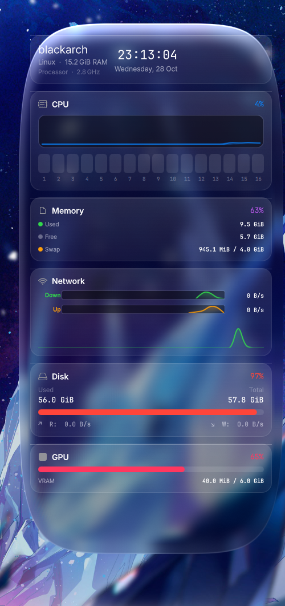

# System Monitor (Glass) for KDE Plasma

A macOS-style system monitor widget for KDE Plasma 6. It renders your CPU,
memory, network, disk and GPU inside a *liquid glass* card — a real-time
frosted blur of your wallpaper with a squircle silhouette, refractive edge,
chromatic aberration and a specular border, all done with custom GLSL
shaders.



<p align="center"><i>Dark liquid glass on an anime wallpaper — CPU ring with
frequency, per-core bars, rolling graph, memory, live network sparklines,
disk with usage-color ramp and an auto-detected GPU section.</i></p>

---

## ویجت نمایشگر سیستم با ظاهر macOS برای کده پلاسما

این ویجت منابع سیستم (CPU، حافظه، شبکه، دیسک و GPU) را داخل یک کارت شیشه‌ای
نمایش می‌دهد؛ افکت شیشه به‌صورت زنده از والپیپر شما بلور می‌گیرد و لبه‌های آن
با شکست نور و هایلایت اسپکیولار شبیه macOS است. برای نصب، بخش
[Install](#install) را ببینید. تنظیمات کامل (بخش‌ها، رنگ، شدت بلور و…) از
منوی راست‌کلیک ویجت در دسترس است.

---

## Features

- **Real liquid glass** — the widget region of your wallpaper is captured
  and blurred through a custom shader pipeline (crop → separable Gaussian →
  compose), with Snell-style edge refraction, chromatic aberration, a
  mouse-following sheen and ordered-noise dithering to prevent banding.
- **macOS materials** — iOS squircle silhouette (superellipse), Tahoe-style
  glass section cards, light/dark appearance, glass or solid material,
  Apple system palette, accent color picker.
- **Stats-app stat cards** — one glass card per metric with an icon,
  semibold title and mono percentage header (components adapted from
  KStats, MIT): per-metric accent colors, JetBrains Mono numerals,
  sparkline meters, per-core tiles, dotted breakdown rows.
- **Host card** — machine name, OS/RAM summary and a live JetBrains Mono
  clock, like a macOS widget header.
- **Sections**
  - CPU — usage sparkline in an inset panel and numbered per-core tiles
  - Memory — Used / Free / Swap breakdown with color dots
  - Network — eased Down/Up meters with throughput sparkline
  - Disk — Used/Total columns, usage-ramp progress bar and mono R/W rates
  - GPU — usage bar and VRAM, shown automatically when sensors exist
- **Panel mode** — a compact glass pill with the CPU ring for panel form
  factors.
- **Zero-polling data** — values come from KDE's `ksystemstats` daemon; the
  update interval is configurable.
- **GPU-friendly** — the blur chain only renders in short bursts after the
  wallpaper or geometry changes, then parks at zero GPU cost. A solid
  (opaque) material is available for low-power setups.

## Requirements

- KDE Plasma **6.1+** (uses `wallpaperGraphicsObject` to sample the wallpaper)
- `ksystemstats` / `libksysguard` (ships with Plasma; provides the sensors)
- For the glass effect: a desktop placement with an image wallpaper. Panels
  and windows-covered states fall back to a translucent material
  automatically. For video wallpapers enable *Continuously sample the
  background* in the widget settings.

## Install

### Option 1 — install script (from the repo)

```bash
git clone https://github.com/owarimono/system-monitor-kde.git
cd system-monitor-kde
./install.sh
```

### Option 2 — .plasmoid bundle

Grab `SystemMonitor-Glass-v*.plasmoid` from
[Releases](https://github.com/owarimono/system-monitor-kde/releases) (or run
`./package.sh`), then in Plasma: right-click desktop → *Add Widgets…* →
*Get New Widgets…* → *Install Widget From Local File…*.

### Option 3 — kpackagetool6

```bash
kpackagetool6 --type=Plasma/Applet --install package/
```

After installing, right-click the desktop → *Add Widgets…* → search for
**System Monitor (Glass)**.

### Uninstall

```bash
kpackagetool6 --type=Plasma/Applet --remove io.github.system-monitor-kde.glass
```

## Configuration

Right-click the widget → *Configure System Monitor (Glass)*:

- **Sections** — toggle each section, per-core bars, graphs, temperature;
  set the update interval (1–10 s) and graph history length (30–600 s).
- **Appearance** — liquid glass or solid material, dark/light/follow-system,
  accent color, blur strength, refractive edge toggle.
- **Performance** — blur 0 px disables the blur chain entirely; the
  continuous-background-sampling option is only needed for animated/video
  wallpapers.

## How it works

```
wallpaper item ──► ShaderEffectSource (capture)
                     │
                     ▼
              crop shader        widget region, UV-mapped
                     │
                     ▼
        Gaussian blur (H → V)      half resolution
                     │
                     ▼
              glass shader       squircle mask + Snell refraction
                                 + chroma + tint + specular + dither
```

Data comes from the `ksystemstats` daemon through the `org.kde.ksysguard.sensors`
QML API — the same source plasma-systemmonitor uses, so sensor ids, units and
formatting stay consistent with the rest of the desktop.

## Development

```bash
./build-shaders.sh   # recompile .frag → .qsb (needs qt6-shadertools)
qmllint package/contents/ui -I /usr/lib/qt6/qml   # static checks
./install.sh         # install/upgrade + restart plasmashell
./package.sh         # build a .plasmoid bundle into dist/
```

The compiled `.qsb` files are committed, so installing a checkout never
requires the shader toolchain — only editing a `.frag` file does. See
[CONTRIBUTING.md](CONTRIBUTING.md) for the layout and commit style.

## Troubleshooting

- **No glass, flat translucent card** — the wallpaper could not be sampled
  (panel placement, unsupported wallpaper plugin). The widget degrades
  gracefully; on the desktop with an image wallpaper you should always get
  glass.
- **GPU section missing** — the `ksystemstats` gpu plugin exposes no sensors
  on your system (check with `plasma-systemmonitor`).
- **Temperature missing** — CPU temperature needs lm-sensors-capable
  hardware; the row hides itself when unavailable.
- **Widget looks wrong on a video wallpaper** — enable *Continuously sample
  the background* in the appearance settings (costs some battery).

## Credits

- The stat UI (sparkline charts, bar meters, detail rows, fixed-slot
  numeric typography) is adapted from
  [KStats](https://github.com/oowl/kstats) by Jun Ouyang — MIT licensed,
  see `LICENSES/KStats-MIT.txt`. KStats is itself a KDE widget inspired by
  the macOS [Stats](https://github.com/exelban/stats) menu-bar app.
- Bundled fonts: [Inter](https://rsms.me/inter/) and
  [JetBrains Mono](https://www.jetbrains.com/lp/mono/) — both SIL OFL 1.1
  (`LICENSES/Inter-OFL.txt`, `LICENSES/JetBrainsMono-OFL.txt`); Inter is
  the closest open match to Apple's SF Pro, JetBrains Mono to SF Mono.
- Design inspired by the excellent
  [liquidglass-kde-widgets](https://github.com/jaxparrow07/liquidglass-kde-widgets)
  by jaxparrow07 — this project is an independent implementation (different
  shader pipeline and code), built for a single system-monitor widget.
- Apple, macOS and iOS are trademarks of Apple Inc. This project is not
  affiliated with or endorsed by Apple. No Apple fonts or artwork are
  bundled.

## License

GPL-3.0 — see [LICENSE](LICENSE).
